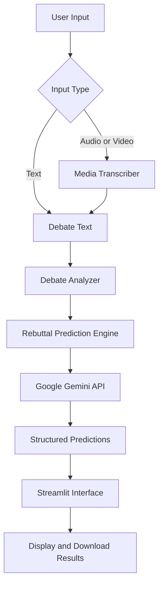

# 🎙️ Speak — AI-Powered Debate Rebuttal Predictor

Speak is an AI-powered debate analysis and rebuttal prediction application built with Python and Streamlit. It helps users analyze debate arguments, identify opposing viewpoints, and predict possible rebuttals using Google's Gemini AI models.

The application supports both **English and Kiswahili** and accepts typed debate content as well as audio and video recordings.

## Features

- **Debate rebuttal prediction:** Generates three potential rebuttals to a debate motion or argument.
- **Debate analysis:** Identifies speakers, debate sides, arguments, claims, reasoning, and rebuttal relationships.
- **Audio transcription:** Converts supported audio recordings into text.
- **Video transcription:** Extracts spoken debate content from supported video recordings.
- **Bilingual support:** Supports English and Kiswahili debate content.
- **Debate-side awareness:** Allows users to select Proposition, Opposition, or Not specified.
- **Structured results:** Presents analysis and predictions in an organized format.
- **Downloadable results:** Allows users to download debate analysis and prediction results as JSON files.

## How It Works

Speak uses Google's Gemini AI models to process debate content and generate structured responses.

The application follows this general workflow:

1. The user enters a debate motion, argument, or uploads an audio/video recording.
2. Uploaded media is transcribed into text.
3. The debate analyzer identifies speakers, arguments, claims, evidence, and rebuttal relationships.
4. The rebuttal engine evaluates the debate content.
5. The system generates three possible rebuttals with explanations and suggested response strategies.
6. Results are displayed through the Streamlit interface.

## System Architecture



## Technology Stack

| Technology | Purpose |
|---|---|
| Python | Main programming language |
| Streamlit | Web application interface |
| Google Gemini API | AI-powered debate analysis and rebuttal prediction |
| Google Gen AI SDK | Communication with Gemini models |
| JSON | Structured AI responses and evaluation data |
| Python-dotenv | Environment variable management |
| Git and GitHub | Version control and project hosting |

## Project Structure

```text
Speak/
│
├── app.py
├── requirements.txt
├── .gitignore
│
├── modules/
│   ├── __init__.py
│   ├── rebuttal_engine.py
│   ├── debate_analyzer.py
│   └── media_transcriber.py
│
└── evaluation/
    └── dataset.jsonl
```

### Main Components

**`app.py`**

The main Streamlit application. It handles user input, media uploads, session state, and the presentation of analysis and prediction results.

**`modules/rebuttal_engine.py`**

Processes debate content and generates three possible rebuttals. It uses prompt engineering and structured responses to provide reasoning, confidence labels, and suggested response strategies.

**`modules/debate_analyzer.py`**

Analyzes debate transcripts to identify speakers, debate sides, arguments, claims, evidence, and relationships between arguments and rebuttals.

**`modules/media_transcriber.py`**

Handles audio and video uploads and converts spoken debate content into text using Gemini.

**`evaluation/dataset.jsonl`**

Contains debate examples used for testing and evaluating the system.

## Installation and Setup

### Prerequisites

- Python 3.10 or later
- Git
- A Google Gemini API key
- An internet connection

### 1. Clone the Repository

```bash
git clone https://github.com/codewithmarcelle/Speak.git
```

Navigate into the project directory:

```bash
cd
```

### 2. Create a Virtual Environment

On Windows:

```powershell
python -m venv venv
```

Activate it:

```powershell
.\venv\Scripts\Activate.ps1
```

If you are using Command Prompt instead:

```cmd
venv\Scripts\activate
```

### 3. Install Dependencies

```bash
pip install -r requirements.txt
```

### 4. Configure Environment Variables

Create a file named `.env` in the project root directory.

Add the following configuration:

```env
GEMINI_API_KEY=your_gemini_api_key
GEMINI_MODEL=gemini-3.5-flash-lite
GEMINI_TRANSCRIPTION_MODEL=gemini-3.5-transcribe
```

Replace the placeholder with your own Gemini API key.

**Important:** Never upload your `.env` file or expose your API key publicly. The `.gitignore` file excludes environment files from Git.

### 5. Run the Application

```bash
streamlit run app.py
```

Streamlit will start the application and provide a local URL, usually:

```text
http://localhost:8501
```

Open the URL in your browser to use Speak.

## Using Speak

1. Launch the application.
2. Enter a debate motion, argument, or upload a supported audio/video file.
3. Select your debate side: Proposition, Opposition, or Not specified.
4. Select the preferred output language.
5. Submit the content for processing.
6. Review the debate analysis and predicted rebuttals.
7. Download the generated results if needed.

## Evaluation

Speak includes an evaluation dataset in `evaluation/dataset.jsonl`.

The project evaluates two main capabilities:

**1. Debate Analysis**
- Speaker identification
- Debate-side identification
- Argument extraction
- Evidence classification
- Rebuttal identification
- Rebuttal target-link accuracy

**2. Rebuttal Prediction**
- Top-three rebuttal coverage
- Relevance
- Plausibility
- Distinctness
- Usefulness

Prediction quality should be assessed against expected answers using human evaluation. AI-generated predictions are possibilities, not guaranteed outcomes.

Actual evaluation results should be reported separately once the measurements have been finalized.

## Limitations

- Predictions depend on the quality and clarity of the supplied debate content.
- AI-generated rebuttals may not cover every possible argument.
- Speaker identification is inferred from the transcript and does not verify a speaker's real identity.
- Transcription accuracy depends on audio quality, background noise, accents, and language.
- Confidence labels are qualitative estimates and should not be interpreted as statistically calibrated probabilities.
- Gemini API access requires an internet connection and may be affected by service availability, rate limits, or usage restrictions.

## Future Improvements

Possible future enhancements include:

- Expanding the debate dataset.
- Improving rebuttal prediction through systematic evaluation and refinement.
- Supporting additional languages.
- Improving speaker and argument relationship detection.
- Adding more advanced debate performance analytics.
- Introducing user accounts and debate history.
- Exploring model fine-tuning or other approaches to improve prediction quality.

## Security

- API credentials are stored in local environment variables.
- The `.env` file should never be committed to the repository.
- Users should protect their API keys and follow Google's API usage policies.


*Speak is an AI-assisted debate analysis and rebuttal prediction prototype. Its outputs are intended to support debate preparation and critical thinking, not replace independent reasoning.*
